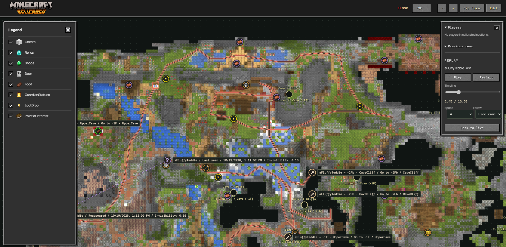

# Relic Rush Dungeon Map

A live map and replay viewer for **Relic Rush**, a Minecraft dungeon crawler minigame we built on **Wereldbouw**.

This started as a one-off companion for our own minigame: a way to see where players are, look back at their adventures, and plan the next run. The map brings the dungeon into your browser, with Minecraft textures, familiar buttons, and player heads moving through its floors.

## Explore, watch, and replay

Explore the dungeon at your own pace, find chests and points of interest, and follow connections between floors. When someone is playing, you can follow their position live as they make their way through the map.

Runs are recorded automatically, even when nobody has the website open. Browse previous runs, search for a player, or choose a date to revisit an attempt. Replay the route, change the playback speed, scrub through the timeline, and follow a player across floors. Solo and co-op runs keep their routes together so you can see how the adventure unfolded.

Invisibility gets its own treatment: the map keeps waiting for the player to return, marks their last-seen and reappearance times, and shows the gap with a purple dotted line. Connections to another floor let you jump straight to the next part of the route.

## A run through the dungeon

The replay view brings the full route together with player positions and playback controls. Use it to revisit your own run, learn from someone else's route, or work out where to go next.

## Play Relic Rush

Want to explore the dungeon yourself? Join **Wereldbouw** at:

**`mc.wereldbouw.net`**

Wereldbouw is a Dutch-speaking Minecraft server, so you'll need to speak Dutch to join in.

## A little about how it works

The map is built from Minecraft schematics and rendered using Minecraft's block models and textures. A server-side tracker reads player positions and saves their routes for live viewing and replay. An editor lets us arrange floors, update the dungeon, and add markers and tracking waypoints without rebuilding the website.

Zooming in loads a separate detail image, rendered from the same geometry at up to 32 pixels per block. The overview stays visible while detail loads, and map coordinates and zoom stay unchanged. Detail resolution is capped by the renderer's 16-million-pixel limit; floors already at that limit retain their base image. Normal startup or the next full project save generates detail images for older maps when Minecraft assets are available. Both image levels are included in backups and reused for marker-only edits. Labels and popovers keep their screen size as the map zooms.

To correct future tracking from a saved run, enter Edit, open the replay, follow a player, pause, and choose **Add tracker point**. Capture uses the last recorded observation at the selected time; choose its correct calibrated section and save. No live player is required, and the recording remains unchanged. The right-hand Players & runs panel can be hidden with its close button and reopened from the button on the right edge.

It runs as a single Docker app, using Node.js, SQLite, and a browser interface. Project exports bundle the map, settings, assets, and recordings into a ZIP that can be restored in a fresh container.

This was made for Relic Rush and the way our dungeon works: a small companion project shaped around our own minigame.
